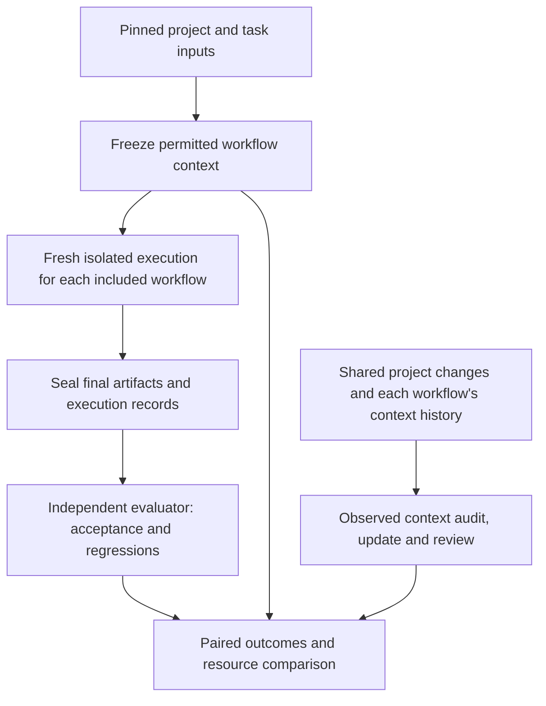

# Draft protocol: evaluating project-context workflows

Status: draft evaluation protocol with project setup tooling; scored execution is not implemented. Revised 2026-11-03. No Memos experiments executed.

## Questions and comparisons

RQ1: What benefits and resource costs do project-context methods produce when coding agents perform development tasks?

RQ2: How much effort is required to keep that context accurate and consistent as the project changes?

Compare complete workflows. Existing project practice preserves native instructions/documentation and ordinary tools. Deliberately prepared context files add versioned guidance to that workflow; construction and loading rules must be frozen later. Record information differences and preparation/update costs. Three method slots are selected: existing workflow, prepared context files and a proposed alternative. The first two are materialized as project scaffolds; the third is a disabled shell. The alternative architecture remains undecided. Retrieval is not mandatory.

## Shared technical flow

The flow specifies orchestration, not the proposed method's internal architecture. Independent executions must never read another workflow's patches, logs, prepared material or conclusions.

## Preparation and freezing

1. Validate setup and baseline behavior before adopting the executable Memos commit. The inspected documentation revision is not validation.
2. Select task requirements and freeze the same prompt, source state and objective evaluator across workflows. Audit baseline and reference behavior where available.
3. Review the initial prepared context pack and its loading notice; freeze final preparation rules before scored execution. Inventory native context and automatically loaded instructions. Record added sources, preparation procedure, artifact hashes, factual review and resources before observing task outcomes. Context preparers cannot see hidden tests or reference solutions.
4. Freeze agent/model/tool/environment versions, execution policies and budgets. Task counts, repetitions and limits require a documented rationale; none is selected here.

## Execution and independent evaluation

Use separate clean checkouts, fresh conversations and isolated writable state. Control caches, external retrieval, network and persistent memory; inventory any permitted shared read-only dependencies. Randomize or counterbalance order once the run plan is chosen. Record order and provider-version limitations.

Agents may run permitted public checks under the common tool policy. End agent sessions and seal final patches before independent hidden evaluation. Evaluate all submitted artifacts against the same acceptance/regression checks and any prespecified review rubric. Distinguish correctness failure, timeout and infrastructure failure. Predetermine retry handling and keep original failed attempts in the evidence.

## Resource recording

Link every attempt to source/context/configuration hashes, logs, patch and evaluation. Record preparation, execution, evaluation and updates as separate phases. Retain raw provider token categories and their overlap semantics; do not double count cached input or reasoning. Record elapsed time and observed active human effort separately. Actual money requires reliable charges/rates; missing fields stay unknown. Inventory available versus actually consumed context.

## Maintenance observations

Use shared before/after code revisions and a common audit scope. Each workflow retains only its own permitted context history. Record checked claims, source/test evidence, stale/contradictory/unsupported findings, edits, resulting hashes and unresolved defects. Log observed detection/repair latency and active preparation/update/review effort. Do not infer labor or maintenance quality from document size or code-execution time alone. Relate maintenance and task outcomes only where the recorded episode supports it.

## Analysis and status boundaries

Use [analysis rules](../../analysis/README.md) and [templates](../../framework/README.md). Report paired task outcomes with denominators, uncertainty and all-attempt resources. Repetition is not an independent new task. Freeze statistical choices before scored data. No method ranking, Memos result or company savings is established. Keep unresolved settings in the [decision register](../../research/open-decisions.md), not as invented paper details.

Project preparation and initial file checks are implemented in [setup tools](tools/setup.py). Agent execution, OS-enforced run isolation, selected tasks and independent evaluation remain future work. No Memos experiments have been executed. See [project setup](README.md).
